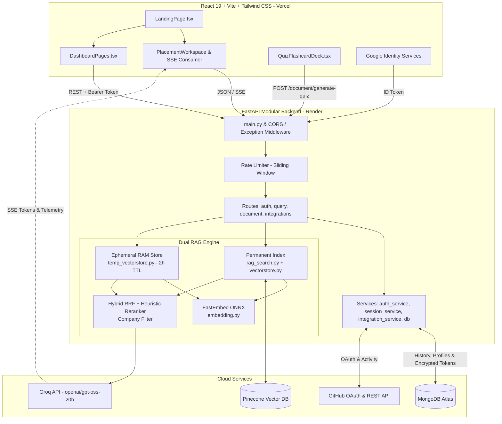

# Placement-Prep AI (v2.0)

> **A full-stack, RAG-powered Campus Placement & Engineering Readiness Platform.**  
> Built with **FastAPI**, **React 19 + TypeScript**, **Pinecone Hybrid Search**, **FastEmbed ONNX**, **Groq (`openai/gpt-oss-20b`)**, **MongoDB Atlas**, and **Google / GitHub OAuth 2.0**.

[](https://placement-prep-rag.vercel.app)
[](https://placementpreprag.onrender.com)
[](https://python.org)
[](https://fastapi.tiangolo.com)
[](https://react.dev)
[](https://www.typescriptlang.org)
[](LICENSE)

---

## Overview

**Placement-Prep** is an end-to-end engineering readiness workspace designed for Computer Science students preparing for technical interviews and campus placements (TCS, Infosys, IBM, Wipro, and product-based SDE roles).

Version 2.0 evolves the project from a standalone RAG chatbot into a **modular, production-hardened preparation hub** combining:
1. **Company-Scoped Hybrid RAG Assistant** with live pipeline telemetry and page-level PDF citations.
2. **Ephemeral Document Intelligence** for private PDF Q&A, AI-generated **Quiz & Flashcard Decks**, and **AI Resume Scoring**.
3. **Engineering Readiness Dashboard** with **GitHub OAuth 2.0** contribution analytics, **LeetCode** progress & heatmap tracking, and a curated **Placement Resources Hub**.

---

## What's New in v2.0

### New Capabilities
- **Modern Landing Experience (`LandingPage.tsx`)**: Animated hero, interactive topic badges, and a visual breakdown of the 4-stage RAG pipeline, with seamless entry and logo-click navigation back to home from both the AI Assistant and Dashboard.
- **Multi-Section Readiness Dashboard (`DashboardPages.tsx`)**:
  - **Overview**: Unified readiness view aggregating GitHub and LeetCode activity heatmaps.
  - **GitHub OAuth 2.0 Integration**: Secure `read:user` OAuth popup flow storing Fernet-encrypted tokens in MongoDB Atlas, displaying 15-minute cached contribution calendars, recent commits, pull requests, and public repositories.
  - **LeetCode Progress Tracker**: Self-reported Easy/Medium/Hard counts, custom DSA topic mastery, daily solve logging, and celebratory canvas particle animations.
  - **AI Resume Reviewer (`POST /document/score-resume`)**: Upload a PDF resume against a target role (e.g., *Software Development Engineer*) for structured AI evaluation, scoring, strengths, and actionable feedback.
  - **Resources Hub**: 17+ curated placement & DSA platforms filterable by category.
- **Interactive Quiz & Flashcard Deck (`QuizFlashcardDeck.tsx`)**: Generate MCQs and interactive flip flashcards directly from any uploaded study PDF (`POST /document/generate-quiz`).
- **Live Pipeline Telemetry (`PipelineVisualizer.tsx`)**: Real-time per-stage millisecond breakdown rendered alongside responses (Query Embedding → Dense Retrieval → BM25 Retrieval → Company Filter → RRF → Heuristic Reranker → Context Construction → Generation).
- **Local-First History + Opt-In Cloud Sync**: Chat history defaults to browser `localStorage` for instant load and privacy; signed-in users can toggle **Cloud Sync** to persist conversations to MongoDB Atlas or export chats to Markdown.
- **Light-First Theme Engine**: Polished **Rose**, **Mint**, and **Sky** themes across both the assistant and dashboard.

---

## Performance & Architecture Improvements

| Area | v1 Baseline | v2 Improvement | Impact |
|---|---|---|---|
| **Embedding Runtime** | Heavy PyTorch + `sentence-transformers` | **FastEmbed ONNX Runtime** (`all-MiniLM-L6-v2`) | Eliminated PyTorch bloat; faster cold starts and significantly lower RAM usage on Render. |
| **Retrieval Accuracy** | Global hybrid search | **Company-Scoped Filtering + Page Citations** | Prevents cross-company context leakage and cites exact `filename.pdf (page N)` sources. |
| **Backend Structure** | Monolithic `main.py` | **Modular `models/`, `routes/`, `services/`** | Clean separation of schemas, HTTP routes, auth, DB, rate limiting, and integrations. |
| **Security & Isolation** | Basic CORS + optional auth | **Rate Limiting, Session Tokens, Fernet, Injection Guard** | Per-route sliding-window rate limits, SHA-256 `X-Document-Token` access control, encrypted OAuth tokens, and `<retrieved_context>` prompt-injection isolation. |
| **Evaluation** | Ad-hoc manual checks | **Automated Retrieval Benchmark & Pytest Suite** | Offline Recall@5, Precision@5, MRR, and NDCG benchmarking + integration & scoping tests. |

### Offline Retrieval Benchmark (`backend/evaluation/baseline-local.json`)
Evaluated across 7 bundled placement PDFs (230 chunks, 8 benchmark queries at `k = 5`):

| Retriever | Recall@5 | Precision@5 | MRR | NDCG@5 |
|---|---|---|---|---|
| **Dense Only** (`all-MiniLM-L6-v2`) | 0.3125 | 0.1250 | 0.3229 | 0.2318 |
| **Hybrid RRF** (`k = 60`) | 0.5000 | 0.1750 | 0.4375 | 0.3554 |
| **Hybrid + Heuristic Reranker** | **0.5000** | **0.1750** | **0.4729** | **0.3553** |

> Hybrid + Reranker delivers a **+60% relative gain in Recall@5** and **+46% gain in MRR** over pure dense vector search, with **~1.4 ms** dense lookup and **~4.3 ms** reranking overhead.

---

## System Architecture



---

## Project Structure

```text
PlacementPrepRAG/
├── backend/
│   ├── main.py                         # FastAPI app, CORS, global handlers, lifespan
│   ├── requirements.txt                # FastAPI, FastEmbed, LangChain, Pinecone, Groq, PyMongo
│   ├── evaluation/
│   │   ├── benchmark_retrieval.py      # Offline Recall@K, Precision@K, MRR, NDCG runner
│   │   ├── baseline-local.json         # Recorded benchmark metrics & stage timings
│   │   └── queries.json                # Evaluation query set
│   ├── tests/
│   │   ├── test_cors_and_quiz.py       # CORS & quiz generation tests
│   │   ├── test_integrations.py        # GitHub OAuth & LeetCode integration tests
│   │   └── test_retrieval_scoping.py   # Company-scoped retrieval & citation tests
│   └── src/
│       ├── models/schemas.py           # Pydantic request/response schemas
│       ├── routes/
│       │   ├── auth.py                 # POST /auth/google
│       │   ├── query.py                # /query, /query/stream, /history/*, /clear
│       │   ├── document.py             # /upload, /document/query*, /generate-quiz, /score-resume
│       │   └── integrations.py         # /integrations/github*, /integrations/leetcode
│       ├── services/
│       │   ├── auth_service.py         # Google ID token verification & caching
│       │   ├── db.py                   # MongoDB Atlas client & collection helpers
│       │   ├── integration_service.py  # Fernet encryption & GitHub API helpers
│       │   ├── rate_limiter.py         # Per-endpoint sliding-window rate limiter
│       │   └── session_service.py      # Ephemeral PDF session tokens (15 MB cap, 2h TTL) & SSE
│       ├── embedding.py                # FastEmbed ONNX chunking & embedding pipeline
│       ├── vectorstore.py              # Pinecone dense + in-memory BM25 + RRF + reranker
│       ├── temp_vectorstore.py         # In-memory session PDF vector store
│       └── rag_search.py               # RAG orchestration, streaming, quiz & resume scoring
└── frontend/
    ├── package.json                    # React 19, Vite 8, TypeScript 6, Tailwind CSS 3.4, Lucide
    └── src/
        ├── App.tsx                     # Root workspace, OAuth popup handler, chat & themes
        ├── hooks/useAuth.ts            # Google session persistence & JWT expiry validation
        └── components/
            ├── LandingPage.tsx         # v2 animated landing page & RAG engine showcase
            ├── DashboardPages.tsx      # Overview, GitHub, LeetCode, Resume Reviewer, Resources
            ├── QuizFlashcardDeck.tsx   # Interactive MCQ & flashcard study deck
            ├── PipelineVisualizer.tsx  # Real-time RAG stage latency breakdown
            ├── AuthModal.tsx           # Google Identity Services modal
            ├── QuoteTooltip.tsx        # Inline source citation tooltip
            ├── ConfirmDialog.tsx       # Destructive action confirmation modal
            └── HelpModal.tsx           # In-app documentation modal
```

---

## Tech Stack

| Layer | Technologies |
|---|---|
| **Frontend** | React 19, TypeScript 6, Vite 8, Tailwind CSS 3.4, Lucide React |
| **Backend** | Python 3.12, FastAPI, Uvicorn, Pydantic v2 |
| **RAG & Embeddings** | Pinecone Vector DB, BM25, Reciprocal Rank Fusion (RRF), FastEmbed ONNX (`sentence-transformers/all-MiniLM-L6-v2`), LangChain |
| **LLM Inference** | Groq API (`openai/gpt-oss-20b`) with Server-Sent Events (SSE) streaming |
| **Storage & Security** | MongoDB Atlas, `cryptography` (Fernet), Google Identity Services (`google-auth`), GitHub OAuth 2.0 |
| **Testing & Quality** | `pytest`, `ruff`, offline retrieval evaluation suite |
| **Deployment** | Vercel (Frontend), Render (Backend) |

---

## Running Locally

### Prerequisites
- **Python 3.12+**
- **Node.js 18+**
- API keys / accounts for **Groq**, **Pinecone**, **MongoDB Atlas**, **Google Cloud OAuth**, and optionally a **GitHub OAuth App**.

### 1. Backend Setup
```bash
git clone https://github.com/ari2387q/PlacementPrepRAG.git
cd PlacementPrepRAG/backend

python -m venv .venv
source .venv/bin/activate  # Windows: .venv\Scripts\activate
pip install -r requirements.txt
```

Create `backend/.env`:
```env
GROQ_API_KEY=your_groq_api_key
PINECONE_API_KEY=your_pinecone_api_key
PINECONE_INDEX=placement-prep
MONGODB_URI=mongodb+srv://...
GOOGLE_CLIENT_ID=your_google_client_id

# GitHub OAuth (optional for dashboard integration)
GITHUB_CLIENT_ID=your_github_client_id
GITHUB_CLIENT_SECRET=your_github_client_secret
GITHUB_REDIRECT_URI=http://localhost:8001/integrations/github/callback
FRONTEND_ORIGIN=http://localhost:5173
CORS_ALLOWED_ORIGINS=http://localhost:5173

# Generate via: python -c "from cryptography.fernet import Fernet; print(Fernet.generate_key().decode())"
INTEGRATION_TOKEN_ENCRYPTION_KEY=your_fernet_key
```

Start the API server:
```bash
uvicorn main:app --reload --port 8001
```

### 2. Frontend Setup
```bash
cd ../frontend
npm install
```

Create `frontend/.env.local`:
```env
VITE_API_URL=http://localhost:8001
VITE_GOOGLE_CLIENT_ID=your_google_client_id
```

Start the dev server:
```bash
npm run dev
```

### 3. Running Tests & Benchmarks
```bash
cd backend
pytest
python evaluation/benchmark_retrieval.py
```

---

## Key Engineering Decisions

1. **FastEmbed ONNX over PyTorch**: Switching from PyTorch-backed `sentence-transformers` to `fastembed` preserves identical `all-MiniLM-L6-v2` 384-d embeddings while cutting container memory usage and startup latency dramatically on memory-constrained cloud instances.
2. **Company-Scoped Hybrid Retrieval**: Pure semantic search often confuses similar interview questions across different companies or misses exact acronyms like `NQT`. Combining Pinecone dense vectors, in-memory BM25, optional company metadata filtering, RRF (`k=60`), and heuristic reranking keeps answers accurate and grounded.
3. **Ephemeral Token-Gated PDF Sessions**: User-uploaded PDFs (up to 15 MB) live in an isolated in-memory store with a 2-hour TTL and SHA-256 `X-Document-Token` ownership verification—preventing index pollution and unauthorized cross-session access.
4. **Local-First Privacy with Opt-In Sync**: Chat histories remain in the user's browser by default and are synced to MongoDB Atlas only when explicitly enabled by a signed-in user.
5. **Self-Reported LeetCode Tracking**: Because LeetCode prohibits automated scraping and offers no official public API for user profiles, LeetCode metrics are transparently labeled as user-entered and persisted per authenticated account.

---

## Author

**Aryan Nair** — BTech CSE @ RIT Kottayam  
GitHub: [@ari2387q](https://github.com/ari2387q)

---

## License
MIT License — feel free to use this project as a reference for your own RAG and full-stack AI applications.
